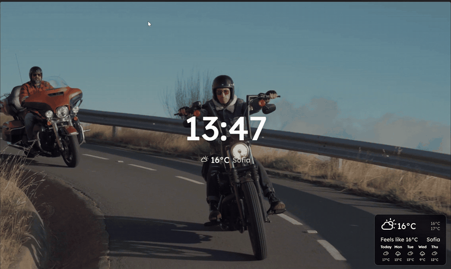

<p align="center">
  
</p>

<h1 align="center">Moo</h1>

<p align="center">Check your plans, leave notes and look things up from a new tab.</p>

<p align="center">
  <a href="#installation"></a>
  <a href="package.json"></a>
  <a href="https://github.com/apoapostolov/Moo-New-Tab-for-Firefox/releases/latest"></a>
  <a href="https://github.com/apoapostolov/Moo-New-Tab-for-Firefox/releases/latest"></a>
  <a href="LICENSE"></a>
</p>

Moo is a personal fork of [Mue](https://github.com/mue/mue) for Firefox and Zen. It gives you somewhere to check the next appointment, leave a reminder and look something up whenever you open a tab. You choose what stays on the page and where it sits.

<p align="center">
  
</p>

The preview uses fictional mail, events, tasks and weather over a real video background. [Compare the three backgrounds](assets/previews/README.md).

## What you can do

- **See what needs your attention.** Read mail, check upcoming events and manage Google tasks beside the clock. Google widgets are optional and need your own Google OAuth client; Settings → Google walks through the setup.
- **Look something up.** Type in AI Ask, then use its service menu to choose a search engine, an AI service or a reference site. The question opens there, so you can look up a fact or carry it into a longer conversation.
- **Keep things you would otherwise lose in another tab.** Leave notes and pictures on the page, save regular destinations as quick links, or enable RSS and add the feeds you follow. Hover a headline to read it; open the original when you want the full site.
- **Make the page fit your day.** Put widgets in the left, centre or right column under Settings → Overview. Choose a clock, set Progress around your working hours, and check the weather before heading out. Narrow and short windows use a scrollable layout.
- **Give the page a background you want to look at.** Use your pictures, stock photos, video clips or live channels. Some sources need a free API key. With a video playing, triple-click the page to hide the widgets and watch; triple-click again or press Escape to return.
- **Take your setup with you.** Export a backup under Settings → Advanced, including uploaded pictures if you want them. Imports show a preview before applying, and sign-in credentials stay out of the backup.

Settings, notes and uploaded pictures are stored in your browser. Weather, backgrounds, feeds and connected Google widgets contact their respective services; [Data and connections](docs/PRIVACY.md) explains what goes where.

## Installation

The [v1.0.0 download](https://github.com/apoapostolov/Moo-New-Tab-for-Firefox/releases/tag/v1.0.0) is an **unsigned development build** for temporary installation:

1. Download `firefox-1.0.0.zip` and extract it.
2. In Firefox or Zen, open `about:debugging` → **This Firefox** → **Load Temporary Add-on**.
3. Select the extracted `manifest.json`, then open a new tab.

Temporary installation ends when the browser restarts. Normal permanent installation in Firefox requires a Mozilla-signed XPI; renaming the ZIP does not sign it. See the [release process](docs/RELEASE_PROCESS.md) for signing and distribution. Installed Firefox/Zen and real Google account workflows still need verification; the [audit record](docs/REFACTOR-PROGRESS.md) lists the checks performed so far.

## Development

Use Bun 1.3.1 and Node 22:

```sh
bun install --frozen-lockfile
bun run dev
```

The local preview is for layout and interaction work. Google sign-in and extension permission prompts need an installed extension.

```sh
bun run test
bun run lint
bun run build
node scripts/validateFirefox.cjs
```

The build writes `build/firefox/` and `build/firefox-<version>.zip`. For temporary installation from source, load `build/firefox/manifest.json` through `about:debugging`.

[Changelog](CHANGELOG.md) · [Report a bug or request a feature](https://github.com/apoapostolov/Moo-New-Tab-for-Firefox/issues) · [Translation guide](docs/TRANSLATING.md)

## Credits and licence

Moo builds on [Mue](https://github.com/mue/mue) by The Mue Authors under the [BSD-3-Clause licence](LICENSE). The original copyright notices and attribution are preserved. Moo is a personal fork and is not affiliated with or endorsed by Mue.

Stock images and video come from Unsplash, Pexels, Pixabay, Coverr and Mixkit. The [preview credits](assets/previews/README.md) identify the footage used in the README. Live channels were found through the [iptv-org index](https://github.com/iptv-org/iptv); each stream remains the property of its broadcaster. Welcome illustrations are from [unDraw](https://undraw.co).
