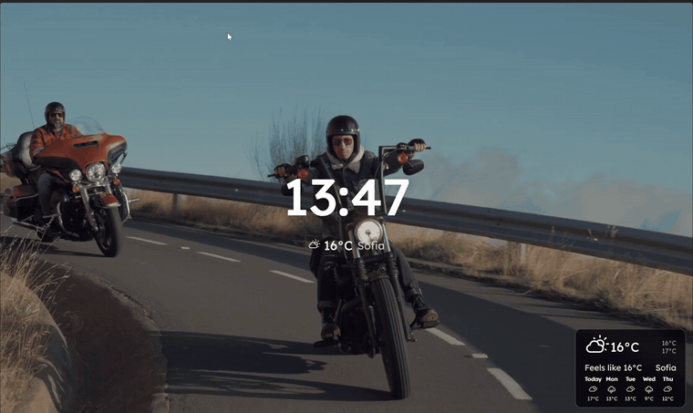

<p align="center">
  
</p>

<h1 align="center">Moo for Firefox</h1>

<p align="center">Check your plans, leave notes and look things up from a new tab.</p>

<p align="center">
  <a href="#installation"></a>
  <a href="package.json"></a>
  <a href="https://github.com/apoapostolov/Moo-New-Tab-for-Firefox/releases/latest"></a>
  <a href="https://github.com/apoapostolov/Moo-New-Tab-for-Firefox/releases/latest"></a>
  <a href="LICENSE"></a>
</p>

Moo is a customizable new tab page for Firefox and Zen. It gives you somewhere to check the next appointment, leave a reminder and look something up whenever you open a tab. You choose what stays on the page and where it sits.

<p align="center">
  
</p>

The preview uses fictional mail, events, tasks and weather over a real video background. [Compare the three backgrounds](assets/previews/README.md).

Moo opens directly in English with the time, Search/Ask Bar, basic weather in the bottom-left corner and Unsplash backgrounds. Other widgets are enabled in Settings.

## Features

- Google widgets: read mail, check upcoming events and manage tasks beside the clock. Set up your own Google OAuth client under Settings → Google, then connect your account and choose the calendars and task list you use. Calendar and Tasks accept English scheduling phrases with a Natural Format guide, notes and a review of the interpreted fields. [Supported syntax](docs/NATURAL-FORMAT.md).
- Search/Ask Bar: enter a question and choose a search engine, AI service or reference site from the service menu. Open a web search, find documentation or continue the question in a conversation.
- RSS reader: enable RSS in Overview and add feeds under Settings → Feeds, or read a Feedly account with a developer token. Headlines appear in one list; hover to read an article when available, or open the original site. Feeds import and export as OPML.
- Floating Notes, Lists, Images and Countdowns: double-click empty space to create a note, then use its menu to change its type, or paste an image onto the page. Settings → Floats controls these features and the Countdown widget; content stays in your browser. Countdown titles can be edited directly on click.
- Quick links: add regular destinations under Settings → Quick Links so the sites you use for a project are available on a new tab.
- Clock and weather: choose a clock, set Progress around your working hours and see current conditions and a five-day forecast for your location.
- Habits: confirm daily routines, selected weekdays or weekly goals in a weekly table. Browse earlier weeks, earn streak badges and hover for details and monthly history. Archiving keeps the habit's history.
- Air Quality: choose a compact AQI reading, a forecast summary or detailed pollutant, UV and pollen readings for a saved city or coordinates. Readings use Open-Meteo's CAMS model forecasts.
- Bookmarks: bring browser bookmarks, Raindrop and Readwise reading together, with recent saves, older discoveries and a shared detail preview. [Setup and options](docs/BOOKMARKS.md).
- GitHub: check review requests, your pull requests, assigned issues and workflow runs through status glyphs and compact tabs. New items receive a count badge, and the last opened tab is restored across sessions. Hover to read the complete description and developer details. Public repositories work with a username; an optional personal token adds access to selected private repositories. [Widget setup and advanced options](docs/HABITS-AIR-QUALITY-GITHUB.md).
- Widget layout: show, hide and arrange widgets in the four corners or centre column under Settings → Overview. The Standard / Focus selector saves separate widget visibility and placement for Focus sessions and Progress clock work shifts. Quick Links can use a separate Focus/Work list; each floating item has a Show in Focus checkbox. Narrow and short windows use a scrollable layout.
- Backgrounds: use local pictures, stock photos, video clips or live channels. Some sources need a free API key. While a video is playing, triple-click the page to hide the widgets; triple-click again or press Escape to return.
- Backups: export your setup under Settings → Advanced, including uploaded pictures if you choose. Imports show a preview before applying, and sign-in credentials stay out of the backup.

Settings, notes, habit progress and uploaded pictures are stored in your browser. Weather, Air Quality, GitHub, Bookmarks, backgrounds, feeds and connected Google widgets contact their respective services; [Data and connections](docs/PRIVACY.md) explains what goes where.

## Installation

Download [Moo 1.0.1 for Firefox](https://github.com/apoapostolov/Moo-New-Tab-for-Firefox/releases/tag/v1.0.1) and extract `firefox-1.0.1.zip`. Install it from the files without using the Mozilla Add-ons store:

1. In Firefox or Zen, open `about:debugging` → **This Firefox** → **Load Temporary Add-on**.
2. Select the extracted `manifest.json`, then open a new tab.

The release archives are unsigned, so this installation lasts until the browser restarts. Standard Firefox requires Mozilla signing for permanent installation; the [release process](docs/RELEASE_PROCESS.md) explains the available distribution methods. The developer instructions below also cover building from source and reloading changes.

## Developer installation for agents

Use Node 22 and Bun 1.3.1. Clone this repository, install its dependencies and build the extension:

```sh
git clone https://github.com/apoapostolov/Moo-New-Tab-for-Firefox.git
cd Moo-New-Tab-for-Firefox
bun install --frozen-lockfile
bun run build
bun run validate:firefox
```

1. Open Firefox or Zen and go to `about:debugging#/runtime/this-firefox`.
2. Choose **Load Temporary Add-on** and select `build/firefox/manifest.json` from the checkout.
3. Open a new tab and confirm that Moo loads. Change a harmless setting, then open another new tab to verify that it persists.
4. After editing source code, run `bun run build` and `bun run validate:firefox`, choose **Reload** on Moo's card in `about:debugging`, then open a fresh new tab to check the change.

This developer installation requires no Mozilla Add-ons account or store submission and works with the unsigned build. It lasts until Firefox or Zen restarts; repeat the load step after a restart. Normal permanent installation in standard Firefox requires Mozilla signing. An unsigned XPI can be installed permanently only in a browser build configured to permit unsigned add-ons. [Mozilla's temporary installation guide](https://extensionworkshop.com/documentation/develop/temporary-installation-in-firefox/).

Agents should use a separate test profile, preserve any existing Moo data and report the browser version, build path, validator result and observed new-tab behavior. Use the installed extension for permission and Google sign-in checks; `bun run dev` provides a web preview for layout work. Never commit account credentials or browser profiles.

## Development

Use Bun 1.3.1 and Node 22:

```sh
bun install --frozen-lockfile
bun run dev
```

The local preview is for layout and interaction work. Google sign-in and extension permission prompts need an installed extension.

```sh
bun run test
bun run lint
bun run build
node scripts/validateFirefox.cjs
```

The build writes `build/firefox/` and `build/firefox-<version>.zip`. Load `build/firefox/manifest.json` through `about:debugging` as described above. See [Contributing](CONTRIBUTING.md) for the development workflow and [Memory testing](docs/MEMORY-TESTING.md) for repeatable background stress tests.

[Changelog](CHANGELOG.md) · [Report a bug or request a feature](https://github.com/apoapostolov/Moo-New-Tab-for-Firefox/issues) · [Translation guide](docs/TRANSLATING.md)

## Credits and licence

Moo builds on [Mue](https://github.com/mue/mue) by The Mue Authors under the [BSD-3-Clause licence](LICENSE). The original copyright notices and attribution are preserved. Moo is not affiliated with or endorsed by Mue.

Stock images and video come from Unsplash, Pexels, Pixabay, Coverr and Mixkit. The [preview credits](assets/previews/README.md) identify the footage used in the README. Live channels were found through the [iptv-org index](https://github.com/iptv-org/iptv); each stream remains the property of its broadcaster. Illustrations retained from Mue are from [unDraw](https://undraw.co).
